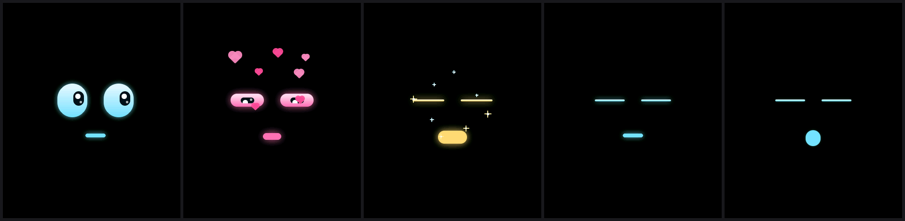
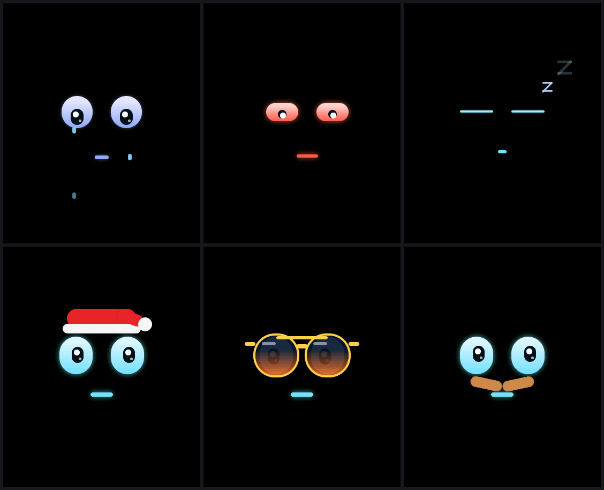
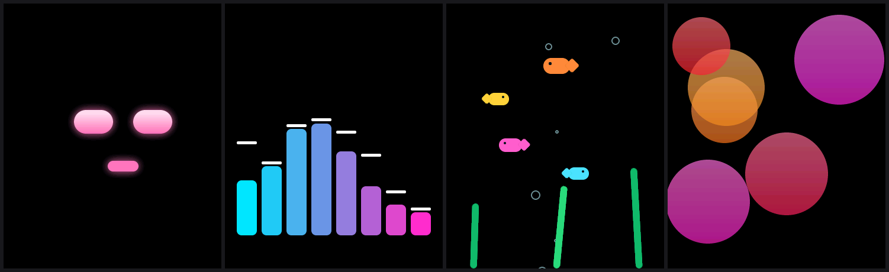

# CHIPO: animaciones extra y pantallas nuevas

Todo esto es **código probado en PC y compilado en GitHub**. **Nada se ha probado todavía en la placa**: el aspecto real en el
AMOLED, la fluidez, el sonido y el consumo se verán cuando llegue (10 dic 2026). Las imágenes de `docs/img/` son capturas 1:1
renderizadas en el PC con el mismo LVGL, no fotos de la pantalla.

Animados: [baile](img/chipo_dance.gif), [visualizador](img/chipo_visualizer.gif), [acuario](img/chipo_aquarium.gif), [lámpara de lava](img/chipo_lava.gif).

## Lote A: cariño y atención
| Qué | Cómo se activa |
|---|---|
| Los ojos siguen el dedo | Mientras tocas la pantalla (la cara se inclina un poco hacia el dedo). Se suelta sola 0,5 s después. No en menús ni pantallas encima. |
| Corazones | Toque simple a la cara (2), decir "gracias", "te quiero", "eres un amor" (5 + cara de amor). |
| Chispas | Cosquillas (varios toques seguidos), al ponerse un disfraz y al empezar a bailar. |
| Parpadeo lento (de gato) | Tras los corazones y solo, cada 50–110 s en reposo. |
| Bostezo con estirón | Al empezar la cara de sueño antes de dormirse, y en cada bostezo (5,2 s) la cara sube un poco. |

## Lote B: estados de ánimo, disfraces
| Qué | Cómo se activa |
|---|---|
| Lágrimas | Mascota **muy descuidada** (ver [CHIPO_PET.md](CHIPO_PET.md)): cada 15 min llora 8 s. También tras la rabieta. |
| Rabieta | CHIPO pierde (**ganas tú** a piedra-papel-tijera o adivinas el número): enfado 1,8 s con la cara temblando y luego lágrimas 3 s. |
| Sueño profundo | Dormido: respiración suave (la cara sube y baja ±2 px cada 4 s, la boca late) y Zzz que suben. |
| Gorro de Papá Noel | Automático del 1 dic al 6 ene (necesita la hora puesta por Internet). "Ponte el gorro de Papá Noel". |
| Gafas de sol / bigote / casco militar | "Ponte las gafas de sol", "ponte un bigote", "ponte el uniforme militar" (boina roja y uniforme verde con charreteras amarillas). |
| Quitar | "Quítate el gorro / las gafas / el bigote / el casco / el disfraz". Lo que tú elijas **gana a la fecha** hasta el próximo arranque (no se guarda). |

## Lote C: sonido
**Baile**: "baila", "ponte a bailar" / "para de bailar", "quieto". La cara rebota y se balancea, la boca sigue el volumen, el brillo cambia
de color y da saltitos con los golpes de volumen. Se acaba solo a los 3 min y mantiene a CHIPO despierto.

**Visualizador de sonido**, **acuario** y **lámpara de lava**: "pon el visualizador", "muéstrame el acuario", "enciende la lámpara de lava".
Se cierran con un toque, "quita eso" o solos a los 10 min.

### De dónde sale el sonido (importante)
`chipo_audio_level` mide **el audio que pasa por CHIPO**: lo que reproduce su altavoz (voz, sonidos ambiente, avisos) y lo que oye el
micrófono. Es un volumen RMS real y 8 bandas reales (Goertzel, 150 Hz–7 kHz; a 16 kHz la de 7 kHz no se puede ver y queda a 0).
Se añaden dos llamadas a `audio_service.cc` (una al reproducir y otra al grabar) que el script `integrate_chipo.py` aplica solo.

Límites honestos:
- La música que suene en **otro aparato** (por ejemplo el reproductor de Home Assistant) solo le llega por el micrófono, y el micrófono
  **solo funciona mientras CHIPO escucha** su palabra de activación o a ti. Si no hay sonido fresco, el baile se balancea suave sin saltos y el visualizador
  muestra una ondita baja.
- Los saltos del baile siguen picos de volumen, **no es detección de tempo**.
- El consumo de las pantallas animadas (colores brillantes a 25 fps) y del baile no está medido.

## Dónde está
`components/chipo_face` (`chipo_fx*`, `chipo_audio_level`, baile, disfraces, lágrimas), `components/chipo_scenes` (pantallas y voz de baile),
`components/chipo_pet` (llorar / rabieta), `components/chipo_settings` (dedo). Pruebas: `tests/host/test_face.cpp`, `test_fx_logic.cpp`,
`test_audio_level.cpp`, `test_scenes_logic.cpp`, `test_scenes.cpp`, `test_pet.cpp`, `test_settings.cpp`. Capturas: `tests/host/render_extras.cpp`.
