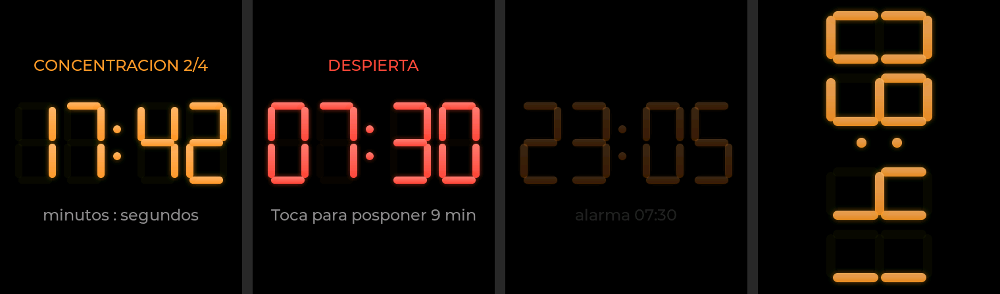

# CHIPO BUDDY: temporizador, pomodoro, cronómetro, alarma y modo dormir

Todo se maneja **por voz** con las frases de abajo. CHIPO responde con un sonido corto y un texto en pantalla,
y el asistente del servidor **no** repite la respuesta (igual que en el modo DRIVE). Código en `components/chipo_buddy`.

Estado: probado solo en PC (lógica de voz, tiempo, pantalla y controlador con LVGL, ASan/UBSan) y compilado en
GitHub Actions. **No probado en la placa.** Ver «Qué falta comprobar».

## Qué dice y qué hace

| Frase (con o sin «Chipo,» delante) | Resultado |
| --- | --- |
| «temporizador de 10 minutos», «avísame en media hora», «cuenta atrás de 30 segundos», «temporizador de una hora y media» | Cuenta atrás. Se ve 6 s y se esconde; sigue corriendo. |
| «cuánto queda» | Vuelve a mostrar la cuenta (si no hay nada en marcha, contesta el asistente). |
| «cancela el temporizador», «para el pomodoro» | Cancela. |
| «pomodoro», «modo concentración» | 25 min de concentración, 5 de descanso, descanso largo de 15 min cada 4 rondas. Sonido en cada cambio. |
| «cronómetro», «para el cronómetro» | Cronómetro (queda visible el tiempo final). |
| «despiértame a las 7 y media», «alarma a las 6:45», «alarma a las ocho menos cuarto de la mañana» | Alarma de una sola vez. Necesita la hora real (ver abajo). |
| «cancela la alarma» | Quita la alarma. |
| «buenas noches», «modo dormir» | Modo dormir: pantalla negra con la hora en ámbar tenue (y la alarma si hay). |
| «buenos días», «sal del modo dormir» o **pulsación larga** en pantalla | Sale del modo dormir. |
| «qué hora es» | Muestra la hora 6 s; **la dice el asistente por voz**. |
| «para», «vale», «silencio» | Para el temporizador o alarma que esté sonando. |

Cuando el temporizador o la alarma suenan, la pantalla se pone roja y el sonido se repite cada 4 s (8 veces como
máximo). **Un toque** en la pantalla la para; si es la alarma, **la pospone 9 min** (hasta 3 veces). Si nadie
contesta, el temporizador termina solo y la alarma se pospone sola (hasta 3 veces).

Un toque corto en modo dormir **no** lo despierta, para que un golpe en la mesita no lo quite.

Las frases largas no cuentan como órdenes (más de 16 palabras se ignoran), y «buenos días» o «para» solo se
interpretan como órdenes cuando hay un modo dormir o un sonido activos; en cualquier otro caso contesta el asistente.
No se activa el modo dormir mientras el modo DRIVE está encendido.

Mientras haya un temporizador, pomodoro, cronómetro o alarma puesta, CHIPO no deja que XiaoZhi lo atenúe ni lo apague
(ver [HARDWARE_2_16.md](HARDWARE_2_16.md#energía-atenuar-y-apagarse-solo)). Con una alarma puesta conviene dejarlo enchufado.

## La pantalla

Reloj retro de cuatro dígitos de siete segmentos, dibujado con rectángulos de LVGL (no necesita fuentes). Por debajo
de una hora muestra minutos:segundos; desde una hora, horas:minutos (el texto de abajo lo indica). Colores:
ámbar (concentración, hora), cian (temporizador), verde (descanso, cronómetro), rojo (suena).

## La hora real

La alarma y el reloj necesitan la hora real. XiaoZhi la recibe del servidor al arrancar (con el huso horario ya
sumado) y CHIPO la lee del reloj del sistema. Antes de recibirla (sin Wi-Fi) el reloj no muestra cifras y **la
alarma no suena**; los temporizadores no dependen de ella.

## Sonidos

`buddy_chime`, `buddy_timer_done` y `buddy_alarm` son tonos sintetizados (sin grabaciones ni derechos). Están en
`components/chipo_drive/clips/` (junto a los del modo DRIVE) y se regeneran con `python3 scripts/make_buddy_sfx.py`.

## Límites conocidos

- Las alarmas y temporizadores **no sobreviven a un reinicio** (no se guardan en memoria).
- Un solo temporizador a la vez, más el pomodoro y el cronómetro.
- «alarma a las doce de la noche» es medianoche; «a las doce» a secas es mediodía.
- No hay detección de golpes en la mesa para posponer: se pospone con un toque en la pantalla.
- Si un sonido falta, se muestra el texto y el asistente contesta por voz como siempre.

## Qué falta comprobar con la placa

- Que el reconocimiento devuelve estas frases como se espera (cifras «10» o palabras «diez»; ambas están cubiertas).
- Que el sonido de la alarma se oye bien por el altavoz y a qué volumen.
- Que la hora del sistema llega con el huso horario correcto en tu servidor.
- Consumo en modo dormir (la pantalla AMOLED con fondo negro apenas consume, pero no está medido).

## Reloj de mesita: CHIPO tumbado de lado

Si pones a CHIPO **tumbado sobre su lado izquierdo** (visto de frente, con el USB-C a la derecha, el puerto queda
**hacia arriba**), pasa esto:

1. Se cae de la pantalla como siempre (sin marearse).
2. A los **10 s** tumbado aparece el **reloj grande**, girado para leerlo de frente, en ámbar. No se duerme mientras
   esté así.
3. Al **levantarlo** vuelve la cara y hace el **«uy, me mareé»** (2,8 s).

Si lo levantas antes de los 10 s, no sale el reloj ni se marea. Tumbado del otro lado, boca arriba o boca abajo no
es un reloj: se comporta como antes (se marea mientras está tumbado). Con el modo DRIVE encendido no se activa.
Los temporizadores y la alarma se ven y suenan igual con el reloj puesto.

Ajustes en `components/chipo_face/include/chipo_config.h`: `CHIPO_DESK_CLOCK_SIDE` (-1 izquierda, +1 derecha,
0 apagado), `CHIPO_DESK_CLOCK_AFTER_MS` (10000), `CHIPO_DESK_CLOCK_DIZZY_MS` (2800).

**Sin comprobar en la placa:** qué lado cuenta como «izquierdo» depende de cómo esté montado el sensor y se deduce
de la primera vez que CHIPO queda quieto y derecho (igual que las inclinaciones). Si en la placa real el reloj sale
al revés o en el lado contrario, basta con cambiar el signo de `CHIPO_DESK_CLOCK_SIDE`.

## Reloj AMOLED

Los dígitos de siete segmentos son tubos luminosos: núcleo claro que se funde con el color saturado, y un halo suave
alrededor de los segmentos encendidos. Los apagados siguen tenues y sin halo, como en un display real, sobre negro
puro (píxeles apagados). Vale igual para el temporizador, la alarma, el reloj de mesita y el reloj de mesa girado.
