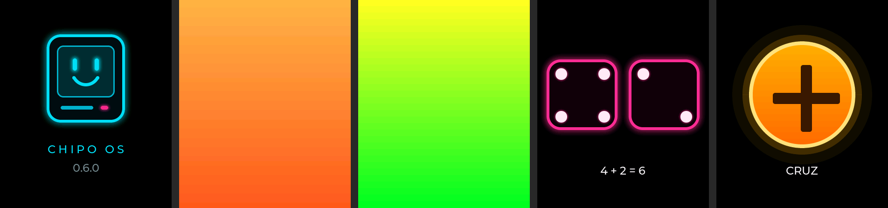
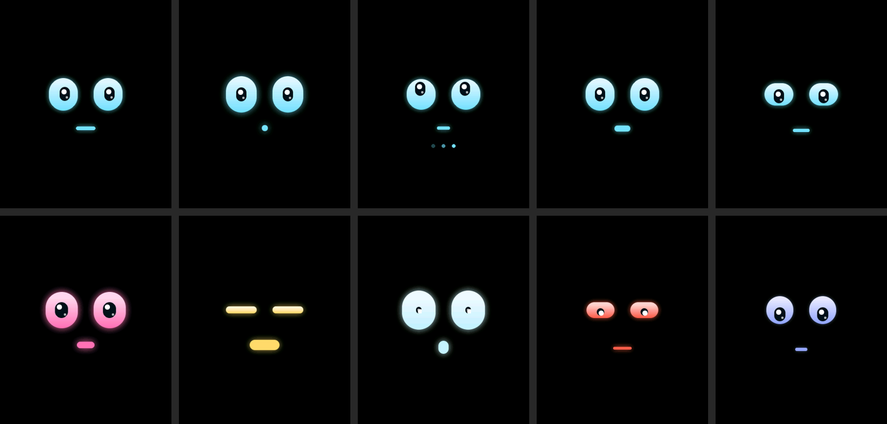

# CHIPO FUN — la pantalla AMOLED a tope

La pantalla AMOLED apaga cada píxel negro y da colores muy saturados. CHIPO FUN aprovecha eso con fondos negros
puros y colores de neón. Todo funciona sin servidor: son pantallas y sonidos del propio firmware.

De izquierda a derecha: pantalla de inicio, lámpara cálida, lámpara arcoíris, dos dados y moneda.

## Qué hace

| Función | Cómo se activa | Detalles |
|---|---|---|
| Pantalla de inicio | Al encender | Un Mac clásico de neón con cara feliz, "CHIPO OS" y la versión. Dura unos 2,6 s; un toque la salta. |
| Lámpara de colores | "Chipo, luz cálida / azul / verde / rosa", "modo lámpara", "arcoíris" | Pantalla completa en degradado. Se apaga con "apaga la lámpara" o con un toque, y sola a los 30 min (gasta mucha batería). |
| Dados | "Tira un dado", "lanza dos dados" | Animación con sonido; muestra el resultado (y la suma con dos dados). Se cierra solo o con un toque. |
| Moneda | "Cara o cruz", "tira una moneda" | La moneda gira y se frena; sale CARA (carita feliz) o CRUZ. |

"Apaga la luz del salón" no es de la lámpara: se queda para Home Assistant.

## Ojos de CHIPO (cara AMOLED)

- Cada ojo es un cristal iluminado: claro arriba y del color saturado del estado abajo (cian en reposo, rosa en amor,
  rojo en enfado, violeta en tristeza...).
- Cada pupila lleva dos brillos (uno grande y uno pequeño) que se mueven con ella y se recortan al cerrar el ojo.
- El halo es 1,3 veces más ancho y 1,25 veces más opaco: sobre negro puro se lee como luz y no como niebla gris.
- Herramienta de capturas: `tests/host/render_faces.cpp`.

## Detalles técnicos

- Componente `components/chipo_fun` (`ChipoFun`), con las órdenes de voz en `chipo_fun_voice.cpp` (sin LVGL, probado aparte).
- Los sonidos (`fun_boot`, `fun_roll`, `fun_coin`) son clips OGG/Opus en `components/chipo_drive/clips`, generados con
  `scripts/make_buddy_sfx.py`. Sin clips, la pantalla sigue funcionando y CHIPO no silencia al asistente.
- Orden de las órdenes de voz: DRIVE, BUDDY, FUN y Home Assistant. Así "luz azul" va a la lámpara y no a Home Assistant.
- FUN se crea antes que BUDDY: si suena una alarma con la lámpara encendida, la alarma se ve por encima.
- Desarrollo: el halo de la moneda son discos translúcidos y no una sombra de LVGL, porque la sombra por software sobre
  una moneda que se estrecha dejaba el render colgado en las pruebas.
- Herramienta de capturas: `tests/host/render_fun.cpp`.

## Qué no está verificado

Nada de esto se ha probado en la placa: reconocimiento de las frases, volumen de los sonidos, fluidez real de la
animación en el ESP32-S3 y consumo de la lámpara.
