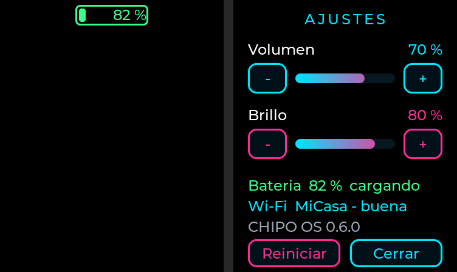

# CHIPO SETTINGS — menú, batería, protector de pantalla y toques

A la izquierda, el indicador de batería (solo aparece al cargar o con poca batería); a la derecha, el menú de ajustes.

## Menú de ajustes

Se abre con una **pulsación larga** en cualquier parte de la pantalla (no se abre encima del clima, el reloj, los
dados o el modo coche). Tiene:

- **Volumen** con − y + (de 10 en 10; suena un aviso para oír el nuevo nivel). Se guarda como el volumen normal de XiaoZhi.
- **Brillo** con − y + (de 10 en 10, nunca por debajo del 5 % para no perder la pantalla). Se guarda como permanente.
- **Batería**: porcentaje y estado (cargando, completa, baja...). Si no hay lectura válida pone «Sin lectura» y no se inventa nada.
- **Wi-Fi**: conectado o no, nombre de la red y calidad de la señal (según el nivel en dBm). El botón **Cambiar Wi-Fi** inicia el modo de configuración nativo de XiaoZhi/Waveshare: detiene la conexión actual y abre el punto de acceso/portal de configuración para elegir otra red e introducir su contraseña. Al terminar, XiaoZhi vuelve a intentar conectarse.
- **Versión** de CHIPO OS.
- **Reiniciar**: pide confirmar (el botón pasa a «Seguro?» durante 3 s); al tocarlo otra vez, reinicia.
- **Cerrar**. También se cierra solo a los 30 s sin tocar.

Mientras el menú está abierto, ningún toque llega a lo de debajo.

## Batería

Un indicador discreto arriba al centro, solo mientras carga (verde) o con batería baja (ámbar; rojo y parpadeando por
debajo del 5 %). Avisa una vez al bajar del 15 % y otra del 5 % (texto y sonido). La lectura la da el AXP2101 a
través de XiaoZhi; si falla, no hay indicador.

## Protector de pantalla (AMOLED)

Sin actividad, la pantalla baja al 40 % a los 90 s y al 15 % a los 5 min; un toque, una conversación o cualquier cambio
de estado la devuelven al brillo del usuario. No baja nunca mientras CHIPO escucha o habla, ni con el clima, el reloj,
los dados o el modo coche en pantalla, ni con el menú abierto. Además la cara se desplaza 3 píxeles como mucho cada
45 s (9 posiciones) para no marcar la pantalla.

## Toques en la cara

Un toque en la zona de los ojos y la boca hace que CHIPO guiñe un ojo; tres toques rápidos (en 1,5 s) le hacen
cosquillas: se ríe y suelta una risita. **Esa zona ya no abre el clima**; el clima sigue abriéndose con un toque en
cualquier otro sitio (arriba o abajo) o por voz, y un toque cierra el clima donde sea.

## Detalles técnicos

- Componente `components/chipo_settings` (`ChipoSettings`), con la lógica sin LVGL en `chipo_settings_logic.cpp` (probada aparte).
- Todo lo que sabe la placa (volumen, retroiluminación, batería, reinicio y cambio de Wi-Fi) entra por funciones (`Hooks`) que conecta `scripts/integrate_chipo.py`. El estado Wi-Fi sale de `esp_wifi_sta_get_ap_info`; el cambio de red reutiliza `WifiBoard::EnterWifiConfigMode()` del firmware base.
- Sus textos son ASCII sin tildes: la fuente integrada de LVGL no tiene acentos.
- Herramienta de capturas: `tests/host/render_settings.cpp`.

## Qué no está verificado

El nuevo botón de cambio de Wi-Fi aún debe probarse en la placa: confirmar que abre el portal de configuración, permite seleccionar otra red y recupera la conexión. Nada se ha probado físicamente en la placa: si la pulsación larga se siente bien en el CST9220, el ajuste real del brillo y del volumen,
la lectura de batería del AXP2101 en esta revisión, el consumo del protector, y que la fuente de XiaoZhi muestre bien los
avisos con tildes.

## Cara cansada con poca batería
Con la batería baja (≤15 %) la cara pone ojos cansados 7 s cada 2 min; en crítica (≤5 %), cada 45 s. Solo cuando no hay nada más en marcha (conversación, pantallas), nunca cargando y nunca sin lectura válida. No sustituye al aviso de batería baja. Sin probar en la placa.

## Registro de compilación (2026-11-27)

- El Action `Build CHIPO firmware` del commit `d767c5e` ejecutó correctamente las pruebas host (incluidos AddressSanitizer y UBSan), pero falló al compilar el firmware para Waveshare.
- Causa detectada en `components/chipo_tools/chipo_tools.cpp`, dentro del recorte de área del trazo: `std::min/std::max` recibían argumentos de tipos distintos (`int` e `int32_t`), error de deducción de plantillas con el toolchain ESP-IDF 6.1.
- Corrección aplicada en el commit siguiente: especificar `int32_t` como tipo de plantilla y convertir explícitamente los límites derivados de `w_` y `h_`.
- Pendiente: esperar y revisar un nuevo Action sobre esta corrección. Esta modificación no se considera validada hasta que la compilación completa termine correctamente.
