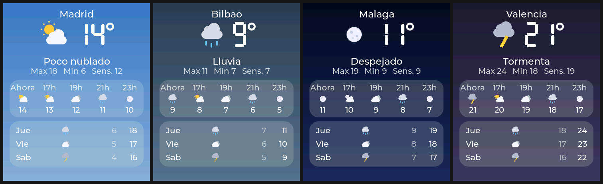
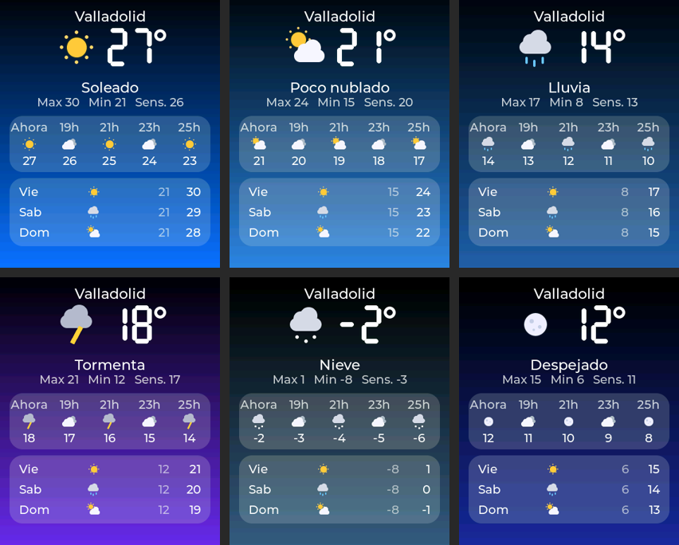

# CHIPO Weather — pantalla del clima

*Capturas hechas en un PC con el mismo código de LVGL y a 368 × 448 (los datos de las capturas son de ejemplo).
Los colores y el brillo del AMOLED real pueden verse algo distintos.*

Una pantalla de clima al estilo de las apps de móvil, dibujada encima de la cara de CHIPO:
ciudad, temperatura grande, icono, máxima/mínima/sensación, las próximas horas y los próximos días.
Todo son formas de LVGL (nada de imágenes ni fuentes extra): los iconos (sol, luna, nubes, lluvia, nieve,
niebla, tormenta) y los números grandes se dibujan por código. El fondo cambia según el tiempo y si es de día o de noche.

## Cómo se abre

| Cómo | Qué pasa |
|---|---|
| **Voz** | Cuando XiaoZhi reconoce lo que dices (`stt`) y suena a pregunta de clima ("¿qué tiempo hace?", "¿va a llover mañana?", "dime la temperatura"…), la pantalla se abre sola mientras el servidor contesta **por voz**. |
| **Toque** | Un toque en cualquier sitio de la pantalla la abre; otro toque la cierra. |

Se cierra sola a los 20 s (`CHIPO_WEATHER_SHOW_MS`) y la cara sigue funcionando por debajo.
La voz sigue siendo la del servidor de XiaoZhi: esta pantalla solo **muestra** el clima, no lo dice ella.

Las palabras que la activan están en `WeatherIntent()` (`components/chipo_weather/chipo_weather_data.cpp`):
clima, temperatura, pronóstico, llover/lluvia, nevar, paraguas, "qué tiempo hace", "hace frío/calor"… Es una lista
de palabras, no entiende el sentido de la frase: "¿cuánto tiempo falta?" **no** la activa, pero alguna frase rara sí
podría. Añadir o quitar palabras es editar esa lista.

## De dónde salen los datos

- **Clima:** [Open-Meteo](https://open-meteo.com) (gratis, sin cuenta ni clave).
- **Ubicación:** por la dirección IP pública (`ipapi.co`, y `ipwho.is` si falla el primero). Es **aproximada**: suele
  dar la ciudad de tu proveedor de internet, que a veces no es la tuya. Para fijarla, compila con
  `-DCHIPO_WEATHER_CITY=\"Sevilla\" -DCHIPO_WEATHER_LAT=37.39 -DCHIPO_WEATHER_LON=-5.99`
  (o cambia los valores en `include/chipo_weather_config.h`).
- Los datos se guardan 10 min (`CHIPO_WEATHER_CACHE_MS`): abrir la pantalla otra vez en ese tiempo no vuelve a
  descargar nada. Si ya hay datos viejos, se enseñan al momento y se refrescan en segundo plano.
- Open-Meteo es gratuito para uso no comercial y tiene un límite diario generoso; con un uso personal no se acerca.
- No hay claves ni contraseñas en el código.

La descarga se hace en una tarea aparte (no en la del LVGL), con HTTPS y comprobación de certificados, y con un tiempo
máximo (`CHIPO_WEATHER_FETCH_TIMEOUT_MS`). Si no hay Wi-Fi o falla, muestra "Sin conexion" unos segundos y se cierra.

## Texto sin tildes

El texto está en español **sin tildes** ("Sens.", "Sin conexion", "Mie"): las fuentes Montserrat que trae LVGL no tienen
acentos. Los nombres de ciudad también se pasan a ASCII ("Málaga" → "Malaga"). El script de integración activa
`CONFIG_LV_FONT_MONTSERRAT_20` y `_24` (unos pocos KB de flash).

## Archivos

| Archivo | Qué hace |
|---|---|
| `components/chipo_weather/chipo_weather_data.cpp` | Lectura de las dos respuestas JSON, iconos por código WMO, detección de voz, quitar tildes. Sin LVGL ni red. |
| `.../chipo_weather_view.cpp` | La pantalla (LVGL). |
| `.../chipo_weather_controller.cpp` | Cuándo abrir/cerrar, descarga en segundo plano, caché, toques. |
| `.../chipo_weather_client.cpp` | Descarga HTTPS (solo en el ESP32). |
| `.../include/chipo_weather_config.h` | Ajustes. |

`scripts/integrate_chipo.py` copia el componente, crea `ChipoWeather` después de la cara y le pasa cada frase
reconocida por voz.

## Pruebas

`tests/host/run.sh` (con `LVGL_DIR`) prueba en un PC, con AddressSanitizer y UBSan: lectura de respuestas válidas,
con espacios, cortadas, con nulos y basura; ubicación por IP; palabras que sí y no activan; abrir por voz, por toque,
cierre automático, caché, datos viejos, fallo de red y parada limpia.

## Lo que NO está comprobado

- **No se ha probado en la placa.** Ni el aspecto real en el AMOLED, ni que el toque llegue (el táctil lo gestiona el
  perfil de XiaoZhi), ni que la descarga funcione desde tu red.
- **Open-Meteo e ipapi.co no se han podido llamar desde el entorno de desarrollo:** el formato de las respuestas se
  ha tomado de su documentación y de ejemplos públicos. Si cambian algún campo, la pantalla mostrará "Sin conexion"
  y el registro serie dirá `unexpected forecast answer`.
- Los archivos que solo se compilan para el ESP32 (`chipo_weather_client.cpp` y la parte de tareas del controlador) se
  han comprobado solo con cabeceras de prueba; la compilación real la hace GitHub Actions.
- Un toque cualquiera abre el clima, también el que despierta a CHIPO del sueño.

## Cielos AMOLED

Los degradados del cielo parten de negro puro arriba (píxeles apagados) hacia un color saturado abajo: azul eléctrico de
día, violeta en tormenta, azul marino de noche. Los datos de la imagen son de ejemplo. Herramienta de capturas:
`tests/host/render_weather.cpp`.
